# Sixty Programs for the Sinclair ZX Spectrum

<p align="center">
  
</p>

In 1983, a computer could take a whole evening to type a program that lasted five minutes. One missed character might turn a space battle into a syntax error. The machine was rarely sympathetic.

SANYALnet Labs brings back all 60 programs from *Sixty Programs for the Sinclair ZX Spectrum*, published by Pan Books in 1983. Its writers were **Robert Erskine, Humphrey Walwyn, Paul Stanley, and Michael Bews**. The book's ISBN is **0-330-28260-3**, and the [World of Spectrum catalog](https://worldofspectrum.org/archive/books/sixty-programs-for-the-sinclair-zx-spectrum) lists its 287-page edition. Our collection pairs readable Sinclair BASIC source with playable ZX Spectrum tapes, book page references, and genuine FUSE screenshots.

Read the [book on the Internet Archive](https://archive.org/details/sixty-programs-for-the-sinclair-zx-spectrum), or visit the [Spectrum Computing book entry](https://spectrumcomputing.co.uk/entry/2000018/Book/Sixty_Programs_for_the_Sinclair_ZX_Spectrum). The book explains the programs; the repository saves your fingers.

## Load it, LIST it, then run it

**The TZX tapes deliberately do not auto-run.** Once a tape finishes loading, the Spectrum stays at the BASIC prompt. We can type `LIST` to study the program before starting it. A screen full of source code is part of the fun, even when it scrolls past faster than expected.

Choose a folder in [`PROGRAMS/`](PROGRAMS/). On a 48K ZX Spectrum in FUSE, attach its `.tzx` tape and load it with `LOAD ""`. Once loading is complete, type:

```basic
LIST
```

This shows the stored BASIC listing. To begin at a specific line, use `LIST 500`, replacing 500 with the desired line number. When you are ready to play, type:

```basic
RUN
```

The original [Sinclair BASIC manual](https://worldofspectrum.net/ZXBasicManual/zxmanchap2.html) explains `LIST`, `LIST n`, and `RUN`. The lack of auto-start is a deliberate choice. It keeps the source available for reading, learning, and editing before the first game begins. A tape that launches itself would skip the best part for curious programmers.

Each folder contains its `.bas` listing, non-auto-run `.tzx` tape, `README.TXT` with book pages and controls, `KEYS-AND-TIMING.TXT`, genuine FUSE screenshots, and `REPLAY.sh`. Some have an extra introduction replay script. These Linux/FUSE helpers record the keys and timing used for the pictures. They are not BASIC compilers.

## Small programs, long stories

### Four writers, one rubber keyboard

The [Science Museum](https://collection.sciencemuseumgroup.org.uk/objects/co62580/sinclair-zx-spectrum-microcomputer-1982-1985) preserves a 48K Spectrum from Sinclair's early-1980s home computer era. Its low price and built-in BASIC helped many people start programming at home. The [Raspberry Pi history of the Spectrum](https://www.raspberrypi.com/news/uncle-clives-greatest-hit-the-zx-spectrum/) describes a world where one programmer could write a game, copy a few cassettes, and advertise it in a magazine. Modest equipment, ambitious plans, and rather a lot of typing.

The book's four writers also appear elsewhere in the Spectrum archives. World of Spectrum links [Paul Stanley](https://worldofspectrum.org/archive/people/paul-stanley) with *Minelay*, *Chomper*, and many action games. Its catalog links [Robert Erskine](https://worldofspectrum.org/archive/people/robert-erskine) with *Morse Tutor*, *Moonlander*, and *Asset Stripper*. [Michael Bews](https://worldofspectrum.org/archive/people/michael-bews) appears alongside *OXO*, *Numbers*, and *Critical Path Analysis*. [Humphrey Walwyn](https://worldofspectrum.org/archive/people/humphrey-walwyn) is listed with *Newmarket*, *Anagrammatic*, and *Countabout*. These are archive credits, not a claim about who typed each line.

The same archive lists related books in German, Spanish, and Italian under those writers. The Italian title is *57 Programmi per Il Sinclair ZX Spectrum*. We can confirm the title, though not which three programs might have missed the journey.

### Space Invaders, Galaxians, and the coin-op invasion

The *Invaders* and *Galaxians* listings belong to the age of packed arcades. Taito's [Space Invaders history](https://spaceinvaders.square-enix-games.com/legacy) dates that landmark shooter to **1978**. Namco's [Galaxian history](https://galaga.com/en/history/galaxian.php) dates its game to **1979** and describes enemies that break formation to dive at the player. Once aliens learned to swoop, standing still became a poor career plan.

The [Strong National Museum of Play](https://artsandculture.google.com/asset/arcade-game-galaxian/lgFWKbehK_wB7Q?hl=en) also records *Galaxian* and its colorful arcade graphics. These BASIC games sit in the same period of space-shooter fever. That does not mean the book's listings are official arcade conversions, or copies of their original code.

### OXO: an opponent older than the Spectrum

*OXO* plays noughts and crosses, a game with an unusually long computer life. In **1952**, Alexander S. Douglas wrote a version for Cambridge University's EDSAC computer. [Guinness World Records](https://www.guinnessworldrecords.com/world-records/first-strategy-game) lists it as an early computer strategy game. The Spectrum appeared three decades later, with a smaller keyboard and rather less floor space.

The 1983 *OXO* listing is its own work. The EDSAC story shows that playing against a machine was already an old idea when this book reached the shops.

### Biorhythms: pretty curves, poor predictions

The *Biorhythms* listing plots a fashionable theory that life follows fixed **23-day, 28-day, and 33-day** physical, emotional, and intellectual cycles. The idea goes back to Wilhelm Fliess and became popular in the late 1960s and 1970s. The plotted curves are real mathematics. Their power to predict your day is a different question.

A [1983 study of 610 top-ranked female athletes](https://pubmed.ncbi.nlm.nih.gov/15676482/) found no significant link between these cycles and peak performance. A later [review of 134 studies](https://pubmed.ncbi.nlm.nih.gov/9775660/) found that biorhythm theory was not valid. It remains an excellent period program to study, but a poor excuse for canceling a picnic.

### Moonlander: the Space Age on a cassette

*Moonlander* puts height and fuel on the screen and leaves the landing to the player. NASA's [Apollo 11 record](https://history.nasa.gov/wp-content/uploads/static/history/alsj/a11/a11ov.html) marks the first crewed Moon landing in **July 1969**. A preserved [Atari game timeline](https://archive.computerhistory.org/resources/access/text/2009/12/500004028.05.01.sm.pdf) dates the *Lunar Lander* arcade machine to **1979**.

The book's program shares that era's fascination with landing safely. We do not present it as a copy of Atari's game. An approaching surface and a shrinking fuel supply can cause enough trouble on their own.

### Morse Tutor: dots, dashes, and 1844

*Morse Tutor* belongs beside the action games because a home computer could also be a classroom. The [International Telecommunication Union](https://www.itu.int/en/history/pages/ITUsHistory.aspx) records Samuel Morse's first telegraph message in **1844**. A code made for messages sent along wires had found another home, this time on a television.

The program's reference chart is worth viewing even if no one intends to send a telegram. The dots and dashes have outlasted an impressive collection of communication gadgets.

### Critical Path Analysis: office work visits the arcade

*Critical Path Analysis* draws on a planning method developed in the **1950s**. In their [history of the method](https://www.pmi.org/learning/library/2019/04/07/15/10/origins-cpm-personal-history-3762), James Kelley and Morgan Walker trace its development to work with DuPont and Remington Rand. Engineers needed to schedule large construction and maintenance jobs, where one late task could hold up the rest.

By 1983, such planning could fit into a BASIC listing next to *Motocross*. Our Spectrum could plan a job, then go racing. The deadlines were probably less fun than the crashes.

## All 60 programs

The images are taken from the collection's FUSE sessions. Select a title to open its folder, or an image to see the original capture.

| No. / Program | What it does | FUSE screenshot |
| :-- | :-- | :-- |
| **01. [Minelay](PROGRAMS/01-minelay/)**<br>Book pp. 7-10 | Collect gold and avoid mines while moving through a maze. | [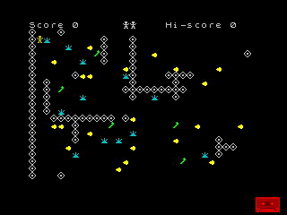](PROGRAMS/01-minelay/SCREENSHOTS/02-MAIN.png) |
| **02. [Fall Guy](PROGRAMS/02-fall-guy/)**<br>Book pp. 11-15 | Guide players through a two-player maze using movement keys. | [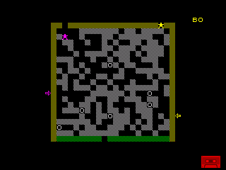](PROGRAMS/02-fall-guy/SCREENSHOTS/03-AFTER-INPUT.png) |
| **03. [Tug Of War](PROGRAMS/03-tug-of-war/)**<br>Book pp. 16-19 | A two-sided tug-of-war game played from the keyboard. | [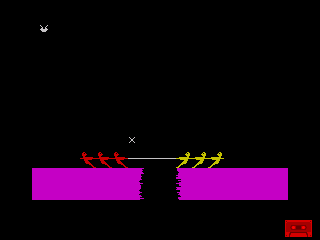](PROGRAMS/03-tug-of-war/SCREENSHOTS/03-AFTER-INPUT.png) |
| **04. [Horse Race](PROGRAMS/04-horse-race/)**<br>Book pp. 20-23 | Choose a horse race and watch the runners compete on the track. | [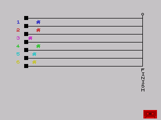](PROGRAMS/04-horse-race/SCREENSHOTS/02-AFTER-INPUT.png) |
| **05. [Championship Boxing](PROGRAMS/05-championship-boxing/)**<br>Book pp. 24-29 | Box in a timed bout with two fighters in the ring. | [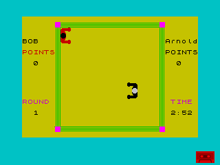](PROGRAMS/05-championship-boxing/SCREENSHOTS/02-AFTER-INPUT.png) |
| **06. [Motocross](PROGRAMS/06-motocross/)**<br>Book pp. 30-33 | Ride an obstacle course and time your jumps. | [](PROGRAMS/06-motocross/SCREENSHOTS/02-AFTER-INPUT.png) |
| **07. [Critical Path Analysis](PROGRAMS/07-critical-path-analysis/)**<br>Book pp. 34-38 | Enter network nodes to draw a critical-path diagram. | [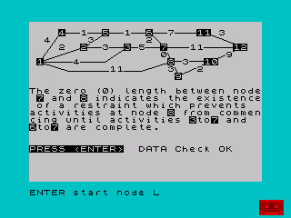](PROGRAMS/07-critical-path-analysis/SCREENSHOTS/03-AFTER-INPUT.png) |
| **08. [Chomper](PROGRAMS/08-chomper/)**<br>Book pp. 39-43 | Guide Chomper through a maze, collect pellets, and score points. | [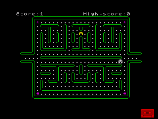](PROGRAMS/08-chomper/SCREENSHOTS/03-AFTER-INPUT.png) |
| **09. [Battleships](PROGRAMS/09-battleships/)**<br>Book pp. 44-48 | Place ships on a grid and play a coordinate-based naval battle. | [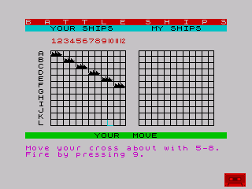](PROGRAMS/09-battleships/SCREENSHOTS/03-AFTER-INPUT.png) |
| **10. [Tanx](PROGRAMS/10-tanx/)**<br>Book pp. 49-52 | Set tank positions and firing angles in a turn-based battle. | [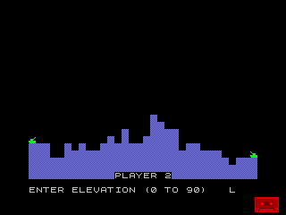](PROGRAMS/10-tanx/SCREENSHOTS/03-AFTER-INPUT.png) |
| **11. [Defend](PROGRAMS/11-defend/)**<br>Book pp. 53-57 | Defend a terrain-based field against moving aliens. | [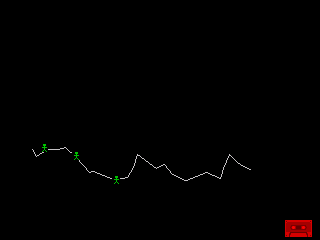](PROGRAMS/11-defend/SCREENSHOTS/03-AFTER-INPUT.png) |
| **12. [Flying Bomb](PROGRAMS/12-flying-bomb/)**<br>Book pp. 58-60 | Pilot an aircraft and choose when to drop a bomb. | [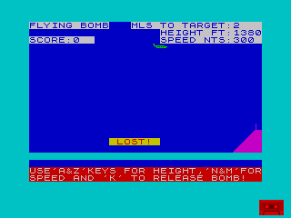](PROGRAMS/12-flying-bomb/SCREENSHOTS/02-AFTER-INPUT.png) |
| **13. [Radio Power](PROGRAMS/13-radio-power/)**<br>Book pp. 61-69 | Enter a radio station and inspect the resulting coverage map. | [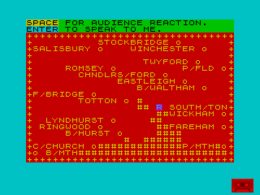](PROGRAMS/13-radio-power/SCREENSHOTS/03-AFTER-INPUT.png) |
| **14. [Scuba](PROGRAMS/14-scuba/)**<br>Book pp. 70-76 | Swim underwater and catch fish while keeping count. | [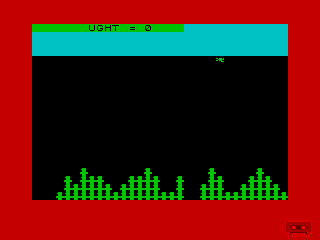](PROGRAMS/14-scuba/SCREENSHOTS/03-AFTER-INPUT.png) |
| **15. [Endings](PROGRAMS/15-endings/)**<br>Book pp. 77-82 | Take turns building words in a game against the computer. | [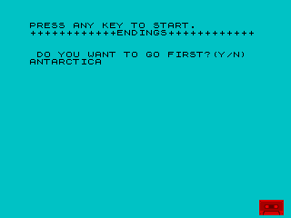](PROGRAMS/15-endings/SCREENSHOTS/01-COMPUTER-RESPONSE.png) |
| **16. [Snap](PROGRAMS/16-snap/)**<br>Book pp. 83-86 | Play a picture-based matching game and respond with the keyboard. | [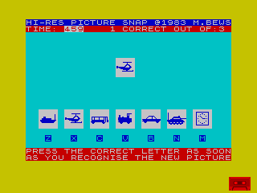](PROGRAMS/16-snap/SCREENSHOTS/02-AFTER-INPUT.png) |
| **17. [Paypackets](PROGRAMS/17-paypackets/)**<br>Book pp. 87-90 | Calculate pay packets from an entered amount and packet count. | [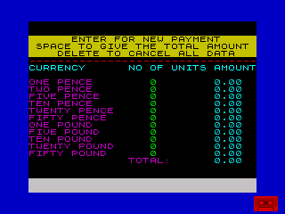](PROGRAMS/17-paypackets/SCREENSHOTS/01-PAYMENT-SCREEN.png) |
| **18. [Newmarket](PROGRAMS/18-newmarket/)**<br>Book pp. 91-95 | Choose a horse and follow its progress in a Newmarket race. | [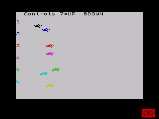](PROGRAMS/18-newmarket/SCREENSHOTS/03-AFTER-INPUT.png) |
| **19. [Hobday Expenses](PROGRAMS/19-hobday-expenses/)**<br>Book pp. 96-103 | Enter holiday expenses and calculate currency amounts. | [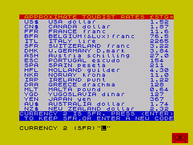](PROGRAMS/19-hobday-expenses/SCREENSHOTS/03-AFTER-INPUT.png) |
| **20. [Ambush](PROGRAMS/20-ambush/)**<br>Book pp. 104-108 | Use the controls in an arcade game called Ambush. | [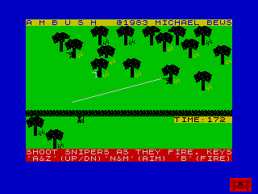](PROGRAMS/20-ambush/SCREENSHOTS/03-AFTER-INPUT.png) |
| **21. [Numbers](PROGRAMS/21-numbers/)**<br>Book pp. 109-114 | Convert between number systems, including Roman numerals. | [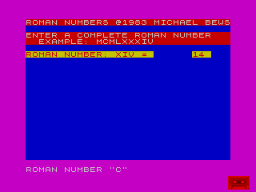](PROGRAMS/21-numbers/SCREENSHOTS/03-AFTER-INPUT.png) |
| **22. [Top Trainer](PROGRAMS/22-top-trainer/)**<br>Book pp. 115-124 | Manage horses and money on a horse-trading board. | [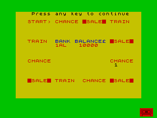](PROGRAMS/22-top-trainer/SCREENSHOTS/02-RACE-SCREEN.png) |
| **23. [Biorhythms](PROGRAMS/23-biorhythms/)**<br>Book pp. 125-127 | Calculate and plot biorhythm curves from dates. | [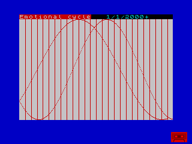](PROGRAMS/23-biorhythms/SCREENSHOTS/03-AFTER-INPUT.png) |
| **24. [Aben](PROGRAMS/24-aben/)**<br>Book pp. 128-130 | Move and shoot through an alien arcade game. | [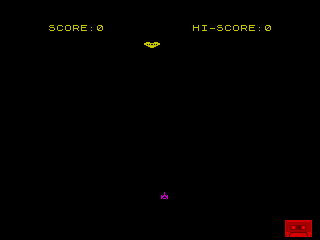](PROGRAMS/24-aben/SCREENSHOTS/02-AFTER-INPUT.png) |
| **25. [Galaxians](PROGRAMS/25-galaxians/)**<br>Book pp. 131-134 | Move and fire in an arcade game against space enemies. | [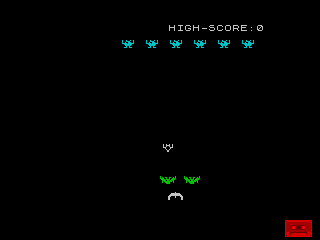](PROGRAMS/25-galaxians/SCREENSHOTS/03-AFTER-INPUT.png) |
| **26. [Sheep Dog Trials](PROGRAMS/26-sheep-dog-trials/)**<br>Book pp. 135-138 | Guide a sheepdog through trials and earn points. | [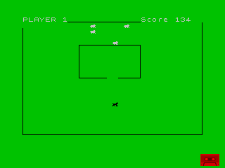](PROGRAMS/26-sheep-dog-trials/SCREENSHOTS/03-AFTER-INPUT.png) |
| **27. [Picture Pairs](PROGRAMS/27-picture-pairs/)**<br>Book pp. 139-144 | Reveal tiles in a picture-pair memory game. | [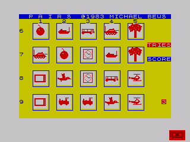](PROGRAMS/27-picture-pairs/SCREENSHOTS/01-REVEALED-BOARD.png) |
| **28. [Dam Busters](PROGRAMS/28-dam-busters/)**<br>Book pp. 145-148 | Use flight controls to line up a bombing run. | [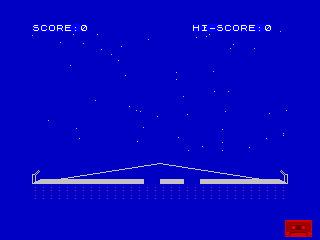](PROGRAMS/28-dam-busters/SCREENSHOTS/03-AFTER-INPUT.png) |
| **29. [Oxo](PROGRAMS/29-oxo/)**<br>Book pp. 149-151 | Play noughts and crosses against a game opponent. | [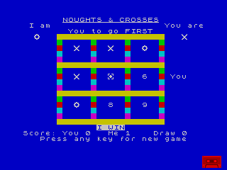](PROGRAMS/29-oxo/SCREENSHOTS/03-AFTER-INPUT.png) |
| **30. [Space Traffic](PROGRAMS/30-space-traffic/)**<br>Book pp. 152-155 | Steer and fire a laser in a space-traffic arcade game. | [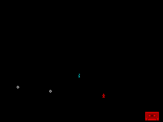](PROGRAMS/30-space-traffic/SCREENSHOTS/02-FLIGHT.png) |
| **31. [Dam Eaters](PROGRAMS/31-dam-eaters/)**<br>Book pp. 156-159 | Aim and drop a bomb at a dam target. | [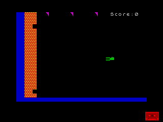](PROGRAMS/31-dam-eaters/SCREENSHOTS/03-AFTER-INPUT.png) |
| **32. [Buzzy Bee](PROGRAMS/32-buzzy-bee/)**<br>Book pp. 160-163 | Move Buzzy Bee among plants and flowers. | [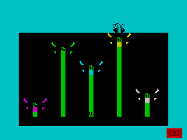](PROGRAMS/32-buzzy-bee/SCREENSHOTS/03-AFTER-INPUT.png) |
| **33. [Heli Bomber](PROGRAMS/33-heli-bomber/)**<br>Book pp. 164-167 | Pilot a helicopter in an arcade bombing game. | [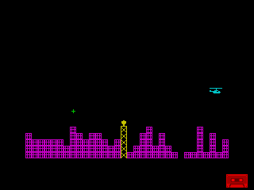](PROGRAMS/33-heli-bomber/SCREENSHOTS/02-AFTER-INPUT.png) |
| **34. [Grand Prix](PROGRAMS/34-grand-prix/)**<br>Book pp. 168-172 | Drive around a Grand Prix racing circuit. | [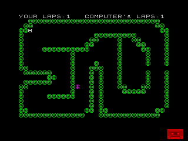](PROGRAMS/34-grand-prix/SCREENSHOTS/03-AFTER-INPUT.png) |
| **35. [Giant Rats](PROGRAMS/35-giant-rats/)**<br>Book pp. 173-176 | Navigate a maze occupied by giant rats. | [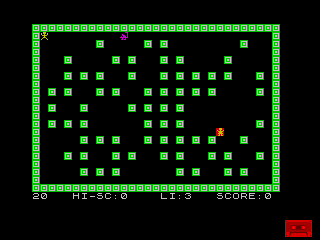](PROGRAMS/35-giant-rats/SCREENSHOTS/03-AFTER-INPUT.png) |
| **36. [Postman](PROGRAMS/36-postman/)**<br>Book pp. 177-180 | Follow a postal route while the clock runs. | [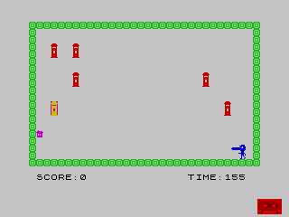](PROGRAMS/36-postman/SCREENSHOTS/03-AFTER-INPUT.png) |
| **37. [Xmas Eve](PROGRAMS/37-xmas-eve/)**<br>Book pp. 181-184 | Play a Christmas game and collect presents. | [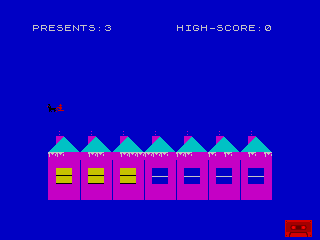](PROGRAMS/37-xmas-eve/SCREENSHOTS/03-AFTER-INPUT.png) |
| **38. [Morse Tutor](PROGRAMS/38-morse-tutor/)**<br>Book pp. 185-189 | Study Morse code with a chart of dots and dashes. | [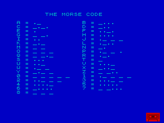](PROGRAMS/38-morse-tutor/SCREENSHOTS/02-MAIN.png) |
| **39. [Flying Geese](PROGRAMS/39-flying-geese/)**<br>Book pp. 190-191 | Aim and fire at moving geese in an arcade game. | [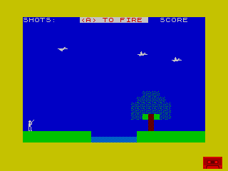](PROGRAMS/39-flying-geese/SCREENSHOTS/02-AFTER-INPUT.png) |
| **40. [Wordsum](PROGRAMS/40-wordsum/)**<br>Book pp. 192-194 | Solve scrambled words and reveal readable answers. | [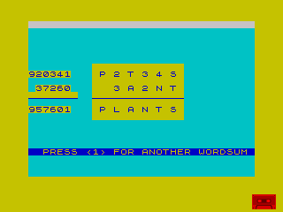](PROGRAMS/40-wordsum/SCREENSHOTS/02-AFTER-INPUT.png) |
| **41. [Asset Stripper](PROGRAMS/41-asset-stripper/)**<br>Book pp. 195-204 | Enter account details and view a financial report. | [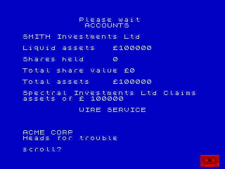](PROGRAMS/41-asset-stripper/SCREENSHOTS/01-ACCOUNT-REPORT.png) |
| **42. [Bricklayer](PROGRAMS/42-bricklayer/)**<br>Book pp. 205-207 | Play Bricklayer and watch your remaining lives. | [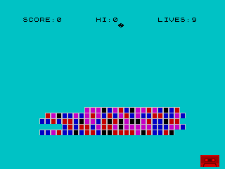](PROGRAMS/42-bricklayer/SCREENSHOTS/02-GAMEPLAY.png) |
| **43. [Dogfight](PROGRAMS/43-dogfight/)**<br>Book pp. 208-212 | Control aircraft during a dogfight. | [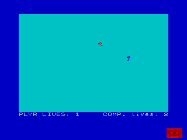](PROGRAMS/43-dogfight/SCREENSHOTS/02-AFTER-INPUT.png) |
| **44. [Evolution 1](PROGRAMS/44-evolution-1/)**<br>Book pp. 213-218 | Play the first Evolution game and see the result of an attempt. | [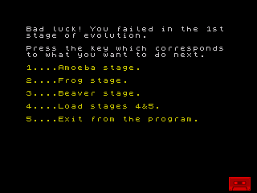](PROGRAMS/44-evolution-1/SCREENSHOTS/03-AFTER-INPUT.png) |
| **45. [Evolution 2](PROGRAMS/45-evolution-2/)**<br>Book pp. 219-224 | Move through a tree and obstacle field in Evolution 2. | [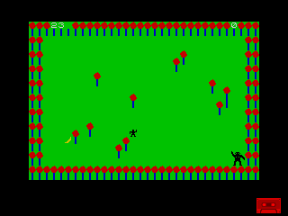](PROGRAMS/45-evolution-2/SCREENSHOTS/03-AFTER-INPUT.png) |
| **46. [Evolution 3](PROGRAMS/46-evolution-3/)**<br>Book pp. 225-230 | Navigate the Evolution 3 world map and encounters. | [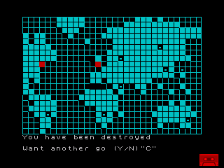](PROGRAMS/46-evolution-3/SCREENSHOTS/03-AFTER-INPUT.png) |
| **47. [Exocet](PROGRAMS/47-exocet/)**<br>Book pp. 231-233 | Fly in Exocet and score points during play. | [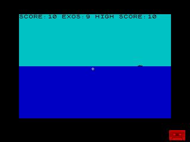](PROGRAMS/47-exocet/SCREENSHOTS/03-AFTER-INPUT.png) |
| **48. [Energy Field](PROGRAMS/48-energy-field/)**<br>Book pp. 234-239 | Navigate the Energy Field game using keyboard controls. | [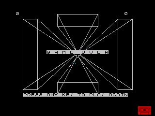](PROGRAMS/48-energy-field/SCREENSHOTS/03-AFTER-INPUT.png) |
| **49. [Drag Racer](PROGRAMS/49-drag-racer/)**<br>Book pp. 240-243 | Drive a drag racer and watch the instruments respond. | [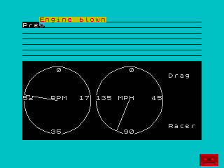](PROGRAMS/49-drag-racer/SCREENSHOTS/03-AFTER-INPUT.png) |
| **50. [Moonlander](PROGRAMS/50-moonlander/)**<br>Book pp. 244-246 | Control a lunar landing while watching height and fuel. | [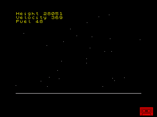](PROGRAMS/50-moonlander/SCREENSHOTS/02-AFTER-INPUT.png) |
| **51. [Anagrammatic](PROGRAMS/51-anagrammatic/)**<br>Book pp. 247-249 | Make letter arrangements from a chosen set of letters. | [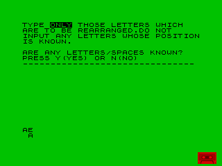](PROGRAMS/51-anagrammatic/SCREENSHOTS/03-AFTER-INPUT.png) |
| **52. [Stellar Run](PROGRAMS/52-stellar-run/)**<br>Book pp. 250-254 | Navigate a space course and avoid destruction. | [](PROGRAMS/52-stellar-run/SCREENSHOTS/03-AFTER-INPUT.png) |
| **53. [Russian Roulette](PROGRAMS/53-russian-roulette/)**<br>Book pp. 255-256 | Try your luck with a simulated revolver and score survival points. | [](PROGRAMS/53-russian-roulette/SCREENSHOTS/02-SURVIVAL-RESULT.png) |
| **54. [Swordsman](PROGRAMS/54-swordsman/)**<br>Book pp. 257-261 | Fight as a swordsman and watch the combat score. | [](PROGRAMS/54-swordsman/SCREENSHOTS/02-SCORE-RESULT.png) |
| **55. [Hangman](PROGRAMS/55-hangman/)**<br>Book pp. 262-266 | Guess letters to reveal a hidden word. | [](PROGRAMS/55-hangman/SCREENSHOTS/03-AFTER-INPUT.png) |
| **56. [Roots](PROGRAMS/56-roots/)**<br>Book pp. 267-271 | Calculate square roots and enter further values. | [](PROGRAMS/56-roots/SCREENSHOTS/03-AFTER-INPUT.png) |
| **57. [Bulls And Cows](PROGRAMS/57-bulls-and-cows/)**<br>Book pp. 272-274 | Guess a four-digit code using bulls-and-cows clues. | [](PROGRAMS/57-bulls-and-cows/SCREENSHOTS/03-AFTER-INPUT.png) |
| **58. [Invaders](PROGRAMS/58-invaders/)**<br>Book pp. 275-279 | Move and fire against invading aliens. | [](PROGRAMS/58-invaders/SCREENSHOTS/03-AFTER-INPUT.png) |
| **59. [Mushroom Invasion](PROGRAMS/59-mushroom-invasion/)**<br>Book pp. 280-282 | Leave the instruction screen and play Mushroom Invasion. | [](PROGRAMS/59-mushroom-invasion/SCREENSHOTS/02-GAMEPLAY.png) |
| **60. [Countabout](PROGRAMS/60-countabout/)**<br>Book pp. 283-290 | Count the houses shown and submit your answer. | [](PROGRAMS/60-countabout/SCREENSHOTS/03-AFTER-INPUT.png) |

## Notes on the collection

The `.bas` listings can be studied in a text editor or with `LIST` on the Spectrum. The `.tzx` tapes preserve the programs and supplementary data while leaving automatic start switched off. Each folder's `README.TXT` identifies its book pages and controls, while `KEYS-AND-TIMING.TXT` and `REPLAY.sh` record the pictured FUSE session.

Every catalog screenshot is from a genuine FUSE run. These pictures show selected program states and key responses, not every route or ending. Our short demonstrations show the programs at work, rather than spending a lifetime chasing every high score.

The history links above describe the people, machines, ideas, and earlier games around this 1983 book. They do not mean that the Spectrum listings were official arcade ports. Where the records run out, the story ends. History has enough odd twists without us inventing extra ones.
